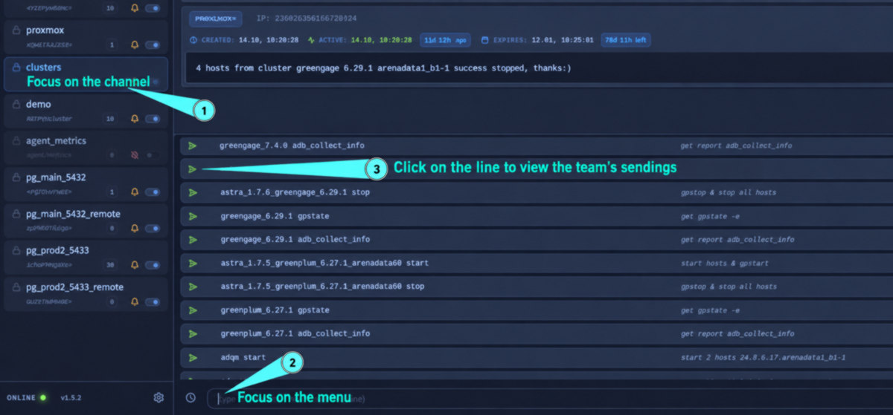
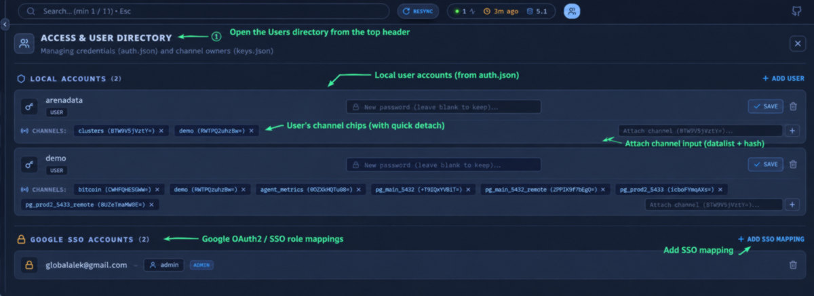

## Gorgona Stheno -> Web UI Documentation

### 1. Overview

**Gorgona Stheno** is an enterprise-grade, real-time command, monitoring, and alerting dashboard for the **Gorgona** peer-to-peer mesh network. An asynchronous FastAPI / WebSocket server, Stheno delivers an ultra-fast, end-to-end encrypted interface for receiving, inspecting, revoking, and transmitting cryptographic alerts across decentralized mesh nodes.

---

### 2. Key Architecture & Security Concepts

* **Asymmetric & Symmetric Cryptography**: Every alert is encrypted using hybrid encryption: AES-256-GCM (data payload) wrapped with RSA-OAEP (SHA-256) per recipient key hash.
* **Deterministic Channel Hashes**: Keys are identified by an 8-byte Base64-encoded SHA-256 digest of their public DER key (e.g., `BTW9V5jVztY=`).
* **Time-Lock Cryptography**: Alerts can specify future unlock times (`unlock_at`). Payloads remain encrypted and masked on the client until the exact unlock timestamp expires.
* **Tombstone Revocations**: Deleting an alert generates a signed cryptographic tombstone packet that propagates across the mesh to permanently evict the alert from all node stores.
* **Role-Based Access Control (RBAC)**:
  * **Admin**: Unrestricted access to all channels, live streams, configuration, and user/SSO management.
  * **User**: Restricted access strictly limited to channels where their username is registered in the channel's `owner` list.
* **Client Isolation**: Background synchronization and forced resyncs are directed privately (unicast) to the requesting session, preventing notification storms or UI freezes in concurrent tabs or sessions.

---

### 3. Real-Time Alert Stream

#### 3.1 Live Stream vs. Channel Views
* **Live Stream Mode**: Aggregates all alerts across all authenticated and active channels into a single unified chronological stream.
* **Channel Mode**: Filters the stream to show only events destined for a selected cryptographic key.

#### 3.2 Dynamic Event Counters
* **Global Counter**: Located next to the **Live Stream** navigation item; dynamically calculates the exact mathematical sum of all active, non-deactivated channels (`Total = Channel₁ + Channel₂ + ...`). It never drifts or counts stale/evicted events.
* **Per-Channel Badges**: Each key in the sidebar displays its own dedicated real-time counter showing the exact number of active alerts held in that channel's memory.

#### 3.3 Alert Card Features
Each event card renders with high-density terminal-like styling and provides:
* **Channel Badge**: Displays the 8-byte recipient key hash in uppercase font.
* **Snowflake Alert ID**: A unique, sortable 64-bit integer ID encoding node identity and creation millisecond timestamp.
* **Timestamps**:
  * **Created**: Human-readable creation time with dynamic "Time Ago" indicator.
  * **Active (Time-Lock)**: Shows when a locked message becomes readable. If locked, payload text is hidden behind a status banner with a live countdown.
  * **Expires**: Countdown to automated TTL expiration. Alerts expiring within 60 seconds highlight in red.
* **Payload Rendering**: Formats text with ANSI color sequences, bracketed color codes (e.g., `[#7aa2f7]`), and active regex/text search highlights.
* **Clipboard Copy**: One-click copying with automated stripping of color/ANSI tags for clean text sharing.
* **Revocation (`Trash2`)**: Submits an immediate revocation request to the mesh node, deleting the alert across all connected sessions.

---

### 4. Navigation & Sidebar Management

#### 4.1 Resizable & Collapsible Sidebar
* **Drag-to-Resize**: Adjust sidebar width smoothly between 180px and 580px; width preference is automatically saved in `localStorage`.
* **One-Click Collapse**: Toggle button collapses the sidebar down to 0px for distraction-free viewing.

#### 4.2 Key / Channel Operations
* **Drag-and-Drop Reordering**: Rearrange channels using vertical drag-and-drop. Order is automatically synced with the backend `keys.json` file.
* **Reorder Lock**: Lock key order in Preferences to prevent accidental drag operations.
* **Channel Activation Switch**:
  * **Deactivate**: Instantly severs the backend TCP connection to the mesh node, purges channel history from server memory, deletes alerts from the UI, and automatically mutes audio/push notifications.
  * **Activate**: Reconnects the TCP client to the node, updates node subscriptions, and pulls history.
* **Mute Channel Notifications (Bell Toggle)**:
  * Silence audio alerts and browser desktop notifications for specific high-volume channels while keeping the visual stream active.
  * Stored independently in local browser storage, allowing individual operator workstation preferences.
* **Inline Channel Rename**: Rename channel aliases directly without affecting cryptographic keys or network hashes.
* **Add Subscription Modal (`+`)**: Upload or paste an RSA private key in PEM format with a friendly alias. The client automatically computes the public key DER hash and initiates the mesh TCP client.

---

### 5. Message Dispatch & Quick Actions

#### 5.1 Encrypted Transmission Panel
Located at the bottom of the interface when viewing a specific channel:
* **Payload Editor**: Multi-line, auto-expanding terminal text input supporting standard markdown and multi-line text (`Shift+Enter`).
* **Time-Lock Timestamp (`unlock_at`)**: Select a future date and time to hold the message in encrypted quarantine until that time arrives.
* **Expiration Timestamp (`expire_at`)**: Set an absolute TTL timestamp after which mesh nodes permanently discard the alert.
* **Fast Keyboard Dispatch**: Pressing `Enter` instantly encrypts with AES-256-GCM + RSA-OAEP and broadcasts to the mesh.

#### 5.2 Quick Actions (Command Templates)
A responsive split-view system for pre-configured one-click templates:
* **50/50 Split Layout**: The left half displays the command/template; the right half displays descriptions or usage examples.
* **Instant Dispatch Arrow**: Green arrow button immediately sends the template text to the channel with default 24h expiration in a single click.
* **Insert to Editor**: Clicking the command text automatically copies it into the main input box for custom editing.
* **Inline Template Management**: Add, edit, reorder (drag-and-drop), or delete templates directly in the interface.

#### 5.3 Quick Actions (Command Chips & Runbook Templates)

[](http://gorgonad.mooo.com)

The **Quick Actions** system provides an inline operational runbook directly above the message dispatch input. It stores channel-specific command templates inside `/etc/gorgona/keys.json` (`quick_actions` array).

##### Why Use Quick Actions?
* **Zero-Latency Incident Response**: Eliminates manual typing during mission-critical events (e.g., database failover, daemon restarts, node isolation).
* **Typo Prevention**: Avoids catastrophic syntax and parameter mistakes under stress.
* **Standardized Team Runbook**: Displays command syntax side-by-side with human-readable operational guidelines.
* **Dynamic Search-As-You-Type**: Typing in the main message box automatically filters the template list in real time against both command text and descriptions.

##### Template Structure (50 / 50 Split Layout)
Each template card is split into two equal sections:
1. **Command Syntax (Left)**: The raw payload/command text to be transmitted.
2. **Operational Description (Right)**: Context, parameters, or usage examples (e.g., `Standby lag check`).

##### How to Add a Template:
1. Select a channel from the sidebar.
2. Focus the message input area at the bottom to expand the Quick Actions panel.
3. Click the dashed **`+ Add Template`** button at the bottom of the list.
4. Enter the command in the left input (`Command / Template...`) and the explanation in the right input (`Description / Example...`).
5. Press **`Enter`** or click the green checkmark (**`Check`**) to save directly to `keys.json`.

##### Usage Workflows:
* **1-Click Instant Dispatch**: Clicking the green send arrow (**`SendHorizontal`**) immediately encrypts (AES-GCM + RSA-OAEP) and broadcasts the template to the mesh with default 24-hour TTL.
* **Copy to Editor**: Clicking the command text automatically populates the main text area, allowing operators to append custom arguments before sending.
* **Inline Editing**: Hover over any template and click the pencil icon (**`Edit2`**) to modify text or descriptions in place.
* **Drag-and-Drop Reordering**: Grab and drag templates vertically to adjust prioritization. Order is permanently synchronized with the backend.
* **Deletion**: Hover and click the **`X`** button to permanently remove the template.
* **Fast Dismissal**: Press **`Escape`** when the message input is empty to hide the Quick Actions panel.
---

### 6. Search, Navigation & "Smart Pulse"

#### 6.1 Search Bar
* **Plain Text Search**: Case-insensitive instant filtering by payload text, alert ID, or channel hash.
* **Regex Engine (`.*` toggle)**: Toggle regular expression mode for advanced pattern matching (e.g., `\d{1,3}\.\d{1,3}`, `err|fatal`, `^[A-Z]{3,}`).
* **Match Navigation**:
  * Step through highlighted matches with `n` / `N` or `ArrowDown` / `ArrowUp`.
  * Visual match counter (`1/X`) indicating current position and total occurrences.
  * `Escape` clears search and restores full view.
* **Autofill Collision Prevention**: Form attributes explicitly prevent browser password managers from erroneously filling search fields with credentials.

#### 6.2 "Smart Pulse" Visual Highlighting
* When returning to an inactive tab or switching to a channel with unread messages, new alerts pulse with an animated accent border and glow for 5 seconds.
* Automatically resets once the channel has been reviewed, avoiding stale visual notifications.

#### 6.3 Scroll Navigation
* Floating **Scroll-to-Top** and **Scroll-to-Bottom** buttons appear dynamically based on scroll offset, allowing instant navigation across large event logs.

---

### 7. User & Access Directory (Admin View)

[](http://gorgonad.mooo.com)

Accessible strictly to users with the `admin` role via the **Users** icon in the top header. Clicking this button replaces the main alert stream with an in-place directory manager.

#### 7.1 Local User Accounts (`auth.json`)
* **Primary Admin Isolation**: The primary `admin` account is protected and excluded from the editable user list (its password is managed via Preferences; its role and deletion are hard-locked).
* **Managed User Rows**:
  * **Role Toggle**: One-click switching between `user` and `admin` roles.
  * **Inline Password Reset**: Directly set a new password without knowing the previous password.
  * **Account Deletion**: Remove credentials and cleanly sever all channel associations.
* **Duplicate Prevention**: Both frontend validation and backend APIs reject duplicate usernames (case-insensitive) and reserve system aliases.

#### 7.2 Multi-Owner Channel Assignment (`keys.json`)
Directly beneath each managed user row, an integrated assignment panel controls access to private channels:
* **Owner Synchronization**: Synchronizes directly with the `"owner": ["user1", "user2"]` array in `/etc/gorgona/keys.json`.
* **Channel Chips**: Shows all channels owned by the user as tags with a quick detach (`×`) button.
* **Attach Channel Input**:
  * Integrated **Datalist**: Dropdown displays all registered channels by friendly alias and hash (e.g., `pg_prod (BTW9V5jVztY=)`).
  * Direct Hash Entry: Accepts raw Base64 channel hashes.
* **Atomic Save**: Clicking **Save** atomically updates user role, password hash, and all channel ownerships in `keys.json`.

#### 7.3 Google OAuth2 / SSO Role Mappings
Configures corporate Google Workspace accounts for zero-trust login:
* **Account Mapping View**: Displays `Google Email` -> `Mapped Local Account` -> `Effective Role`.
* **Add SSO Mapping**:
  * Enter Google Email (e.g., `operator@company.com`).
  * Pick an existing local account from suggestions (e.g., `arenadata`).
  * Select role (`user` or `admin`).
* **Instant Revocation**: Remove Google account access with one click.

---

### 8. Preferences & Settings

Accessible via the gear icon in the sidebar footer:
* **Alert History Limit**: Configure the depth of messages retained in memory per channel (stepper adjustments by ±5). Dynamically updates node subscriptions without restarting.
* **Audio Alerts**: Enable or disable audio chimes on incoming alerts.
* **Fast Revoke**: Bypass confirmation dialogs when deleting alerts for rapid triage.
* **Lock Key Order**: Disables drag-and-drop handles in the sidebar to prevent layout alterations.
* **Theme Selector**: Instant client-side switching between **Tokyo Night**, **Catppuccin**, and **Light** color themes.
* **Security Access (Self-Service)**: Allows any logged-in user (including primary `admin`) to update their own account password.
* **Terminate Session**: Invalidate local session tokens and log out.

---

### 9. System Metrics Widget

Located in the top application header, providing real-time telemetry from the underlying Gorgona C daemon:
* **Peers**: Number of authenticated peer nodes currently connected in the mesh network.
* **Last Ingest Indicator**: Relative time since the last network ingestion event. Color-coded thresholds:
  * **Active (Blue)**: Ingest within the last 2 minutes.
  * **Quiet (Orange)**: Ingest within 2–15 minutes.
  * **Stale (Red)**: Inactivity exceeding 15 minutes.
* **Database Size**: Live storage consumption of the local node database rendered in Megabytes (`MB`).

---

### 10. Webhook & API Integrations

The backend provides authenticated REST endpoints for automated integrations and monitoring scripts:

#### Send Alert Webhook
* **Endpoint**: `POST /api/webhook/send`
* **Headers**: `Authorization: Bearer <TOKEN>`
* **Payload**:
```json
{
  "hash": "BTW9V5jVztY=",
  "text": "CRITICAL: Database failover initiated on node 02",
  "unlock_at": 0,
  "expire_at": 1735776000
}
```

#### Metrics Endpoint
* **Endpoint**: `GET /metrics`
* **Authentication**: HTTP Basic Auth with node PSK.
* **Format**: Prometheus-compatible metric text.

---

### 11. Keyboard Shortcuts Summary

| Key / Combination | Context | Action |
| :--- | :--- | :--- |
| `Enter` | Message Dispatch Area | Send encrypted message to mesh |
| `Shift + Enter` | Message Dispatch Area | Insert newline in message text |
| `Escape` | Message Dispatch Area | Clear entered text / dismiss chips |
| `Escape` | Search Input | Clear active search and filters |
| `n` / `N` | Global Window | Next / Previous search match highlight |
| `ArrowDown` / `ArrowUp` | Search Input | Next / Previous search match highlight |
| `Escape` | Modal Windows | Close active confirmation or dialog |
